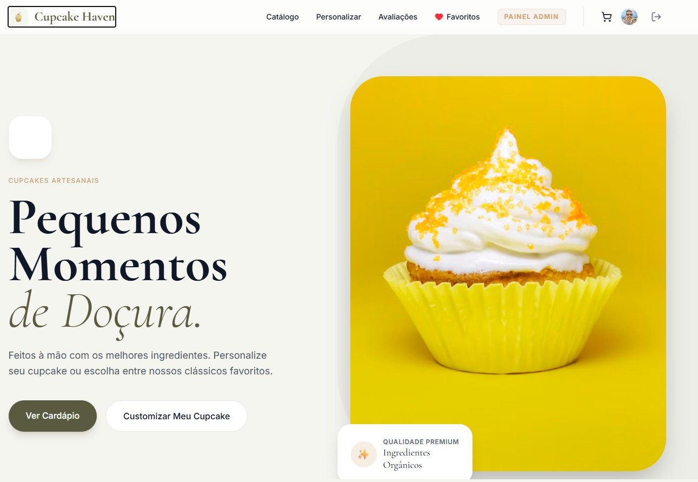

<div align="center">
  

  # 🧁 Cupcake Haven — Confeitaria Artesanal & E-commerce

  <p align="center">
    <strong>Uma plataforma web moderna, fluida e responsiva para catálogo, personalização interativa e gestão de pedidos de confeitaria artesanal.</strong>
  </p>

  <p align="center">
    <a href="https://react.dev/"></a>
    <a href="https://www.typescriptlang.org/"></a>
    <a href="https://tailwindcss.com/"></a>
    <a href="https://vitejs.dev/"></a>
    <a href="https://firebase.google.com/"></a>
  </p>
</div>

---

## 📌 Sumário

1. [Visão Geral](#-visão-geral)
2. [Funcionalidades Principais](#-funcionalidades-principais)
3. [Tecnologias Utilizadas](#-tecnologias-utilizadas)
4. [Estrutura do Projeto](#-estrutura-do-projeto)
5. [Instalação e Execução Local](#-instalação-e-execução-local)
6. [Configuração do Firebase](#-configuração-do-firebase)
7. [Regras de Segurança](#-regras-de-segurança-firestorerules)
8. [Autor & Repositório](#-autor--repositório)
9. [Licença](#-licença)

---

## 📖 Visão Geral

O **Cupcake Haven** é uma solução completa de comércio eletrônico focada no segmento de confeitaria artesanal premium. O sistema integra catálogo de produtos dinâmico, simulador visual e interativo de montagem de cupcakes, checkout com suporte a pagamento via PIX instantâneo, mural comunitário de feedbacks/comunicados e um dashboard administrativo com métricas gerenciais em tempo real.

O projeto foi arquitetado com foco em alta performance, experiência de usuário limpa e intuitiva (UI/UX refinada), responsividade total para dispositivos móveis e persistência segura em nuvem através do Google Cloud Firestore.

---

## 🌟 Funcionalidades Principais

### 🛍️ Vitrine & Catálogo de Produtos
- **Categorização Dinâmica**: Filtragem por categorias (*Clássicos*, *Sazonais*, *Veganos*).
- **Busca em Tempo Real**: Localização ágil de produtos por nome ou descrição.
- **Favoritos Integrados**: Salve cupcakes prediletos associados diretamente à conta do usuário.
- **Controle de Estoque e Disponibilidade**: Indicação imediata de produtos ativos e esgotados.

### 🎨 Personalizador Interativo de Cupcakes
- **Montagem em Camadas**: Escolha personalizada de massa (Baunilha, Chocolate Belga, Red Velvet, Cenoura), recheio (Brigadeiro Gourmet, Ninho com Nutella, Frutas Vermelhas), cobertura (Chantininho, Buttercream, Ganache) e confeitos (Granulado belga, raspas, glitter comestível).
- **Cálculo de Preço Dinâmico**: Atualização automática do valor final conforme os ingredientes e recheios selecionados.
- **Adição Direta ao Carrinho ou aos Favoritos**: Salve suas receitas personalizadas para pedir novamente no futuro.

### 🛒 Carrinho, Checkout & Pagamento
- **Gestão de Itens**: Aumento, redução e exclusão de itens padrão ou personalizados com cálculo automático de subtotal e frete.
- **Múltiplos Meios de Pagamento**: PIX com geração de QR Code e código copia-e-cola, Cartão de Crédito/Débito e Dinheiro na entrega.
- **Gestão de Endereços**: Cadastro de múltiplos endereços de entrega com definição de endereço padrão.

### 📦 Histórico & Rastreamento de Pedidos
- **Linha do Tempo em Tempo Real**: Acompanhamento dos estágios do pedido (*Recebido*, *Em Preparo*, *Saiu para Entrega*, *Entregue*).
- **Comprovantes & Detalhamento**: Visualização clara de itens adquiridos, observações, dados de entrega e forma de pagamento.

### ⭐ Mural de Avaliações & Avisos da Loja
- **Avaliações Verificadas**: Sistema de pontuação de 1 a 5 estrelas com comentários de clientes autenticados.
- **Edição e Exclusão**: Usuários podem editar ou remover suas próprias avaliações.
- **Avisos Oficiais**: Fixação de comunicados, promoções da semana e horários especiais de funcionamento com tags de destaque.

### 📊 Painel Administrativo (Admin)
- **Dashboard Gerencial**: Gráficos analíticos de faturamento diário e ranking de produtos mais vendidos desenvolvidos com `Recharts`.
- **Gestão de Catálogo**: Cadastro, edição de preço/estoque, upload de imagens e desativação temporária de itens.
- **Gerenciador de Avisos**: Criação e publicação imediata de avisos exibidos no mural.
- **Controle de Acesso Baseado em Papéis (RBAC)**: Proteção de rotas para administradores autenticados.

---

## 🛠️ Tecnologias Utilizadas

| Tecnologia | Finalidade |
| :--- | :--- |
| **React 19** | Biblioteca para interfaces de usuário com componentes declarativos e hooks modernos |
| **TypeScript 5.8** | Tipagem estática rigorosa para robustez e manutenção do código |
| **Tailwind CSS v4** | Framework utilitário de estilização para design responsivo e consistente |
| **Vite 6** | Build tool e servidor de desenvolvimento ultra-rápido |
| **Firebase Firestore** | Banco de dados NoSQL em tempo real para sincronização de pedidos, produtos e reviews |
| **Firebase Authentication** | Autenticação de clientes e administradores com Google Sign-In |
| **Lucide Icons** | Conjunto elegante de ícones vetoriais leves |
| **Recharts** | Biblioteca de renderização de gráficos analíticos para o dashboard administrativo |
| **Motion** | Animações suaves de transição de tela e interações |

---

## 📂 Estrutura do Projeto

```text
cupcake-haven/
├── public/                       # Arquivos públicos estáticos (imagens, logotipo, favicon)
│   ├── banner.png                # Screenshot oficial de apresentação da aplicação
│   ├── logo.png
│   ├── hero_cupcake.png
│   └── red_velvet.jpg
├── src/
│   ├── components/               # Componentes visuais modulares
│   │   ├── Addresses.tsx         # Gestão de múltiplos endereços do cliente
│   │   ├── AdminDashboard.tsx    # Gráficos analíticos e métricas financeiras
│   │   ├── AdminPanel.tsx        # Gestão de produtos, estoque e avisos
│   │   ├── Cart.tsx              # Modal e fluxo de carrinho e checkout
│   │   ├── Catalog.tsx           # Grid de produtos com filtros e favoritos
│   │   ├── Customizer.tsx        # Construtor visual de cupcakes personalizados
│   │   ├── Favorites.tsx         # Galeria de produtos favoritados
│   │   ├── Footer.tsx            # Rodapé institucional e links
│   │   ├── Hero.tsx              # Seção principal de boas-vindas com CTA
│   │   ├── Navbar.tsx            # Barra de navegação responsiva com menu mobile
│   │   ├── OrderHistory.tsx      # Rastreamento de pedidos e status
│   │   ├── Profile.tsx           # Perfil do usuário e dados da conta
│   │   └── ReviewsAndNotices.tsx # Mural comunitário de feedbacks e comunicados
│   ├── lib/
│   │   ├── AuthContext.tsx       # Provedor global de estado de autenticação e RBAC
│   │   ├── CartContext.tsx       # Provedor global do carrinho e persistência local
│   │   └── firebase.ts           # Inicialização e configuração do SDK do Firebase
│   ├── App.tsx                   # Roteamento principal e composição da página
│   ├── index.css                 # Importação de estilos globais Tailwind CSS
│   └── main.tsx                  # Ponto de entrada do React DOM
├── firestore.rules               # Regras de segurança e autorização do Firestore
├── index.html                    # Entry point HTML com metadados e OpenGraph
├── package.json                  # Dependências e scripts do projeto
├── tsconfig.json                 # Configurações do compilador TypeScript
└── vite.config.ts                # Configurações do bundler Vite
```

---

## 🚀 Instalação e Execução Local

### Pré-requisitos
- **Node.js** (versão 18 ou superior instalada em seu sistema)
- Gerenciador de pacotes **npm** ou **yarn**

### Passo a Passo

1. **Clonar o Repositório:**
   ```bash
   git clone https://github.com/Evandrorezoli/Evandro-Rezende.git
   cd Evandro-Rezende
   ```

2. **Instalar as Dependências:**
   ```bash
   npm install
   ```

3. **Configurar as Variáveis de Ambiente:**
   Crie um arquivo `.env` ou configure o arquivo `firebase-applet-config.json` na raiz do projeto com as credenciais do seu projeto Firebase:
   ```env
   VITE_FIREBASE_API_KEY=sua_api_key_aqui
   VITE_FIREBASE_AUTH_DOMAIN=seu-projeto.firebaseapp.com
   VITE_FIREBASE_PROJECT_ID=seu-projeto-id
   VITE_FIREBASE_STORAGE_BUCKET=seu-projeto.appspot.com
   VITE_FIREBASE_MESSAGING_SENDER_ID=seu_sender_id
   VITE_FIREBASE_APP_ID=seu_app_id
   ```

4. **Executar em Modo de Desenvolvimento:**
   ```bash
   npm run dev
   ```
   Acesse a aplicação no navegador em `http://localhost:3000`.

5. **Compilar para Produção:**
   ```bash
   npm run build
   ```

---

## 🔒 Regras de Segurança (firestore.rules)

O banco de dados Firestore conta com controle de acesso refinado para garantir que clientes só visualizem e alterem seus próprios registros:

- **Produtos & Avisos**: Leitura pública para todos os visitantes; criação e edição restritas a administradores (`role == 'admin'`).
- **Avaliações**: Leitura livre para todos os clientes; criação e exclusão restritas ao próprio autor autenticado (`authorId == request.auth.uid`) ou administradores da loja.
- **Favoritos & Endereços**: Isolados no caminho seguro do usuário (`/favorites/{userId}/items` e `/users/{userId}/addresses`), permitindo acesso exclusivo ao titular da conta.
- **Pedidos**: Clientes podem registrar novos pedidos e consultar seu histórico pessoal; atualização de status restrita à gerência.

---

## 👨‍💻 Autor & Repositório

Desenvolvido por **Evandro Rezende de Oliveira**

- **GitHub**: [https://github.com/Evandrorezoli](https://github.com/Evandrorezoli)
- **Repositório do Projeto**: [https://github.com/Evandrorezoli/Evandro-Rezende.git](https://github.com/Evandrorezoli/Evandro-Rezende.git)
- **E-mail de Contato**: `evandrorezoli@gmail.com`

---

## 📄 Licença

Este projeto está licenciado sob a licença [MIT](LICENSE). Sinta-se livre para utilizar, modificar e distribuir conforme as diretrizes da licença.
